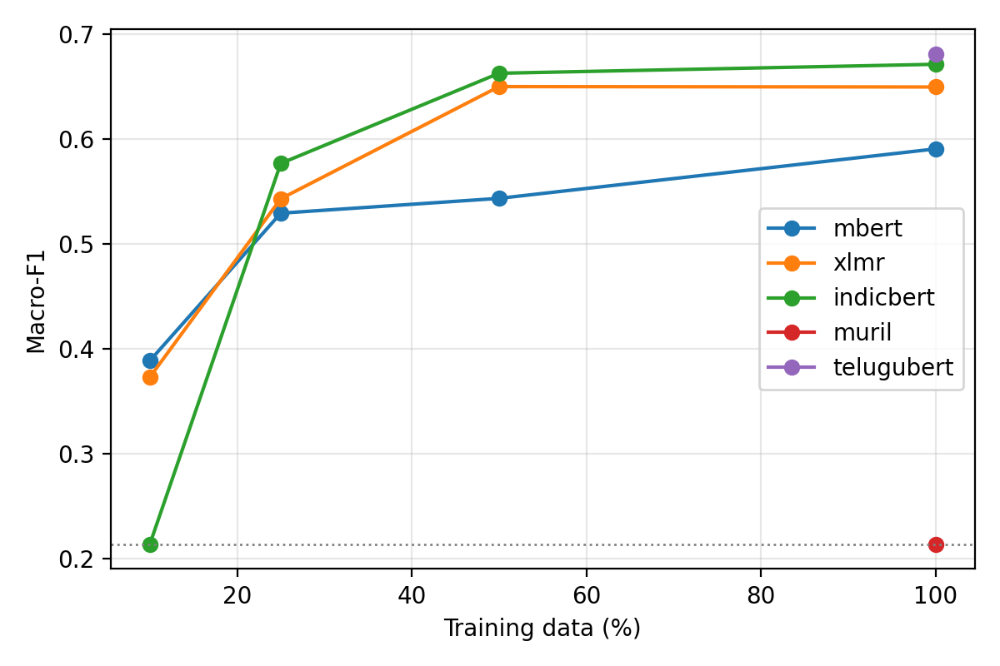
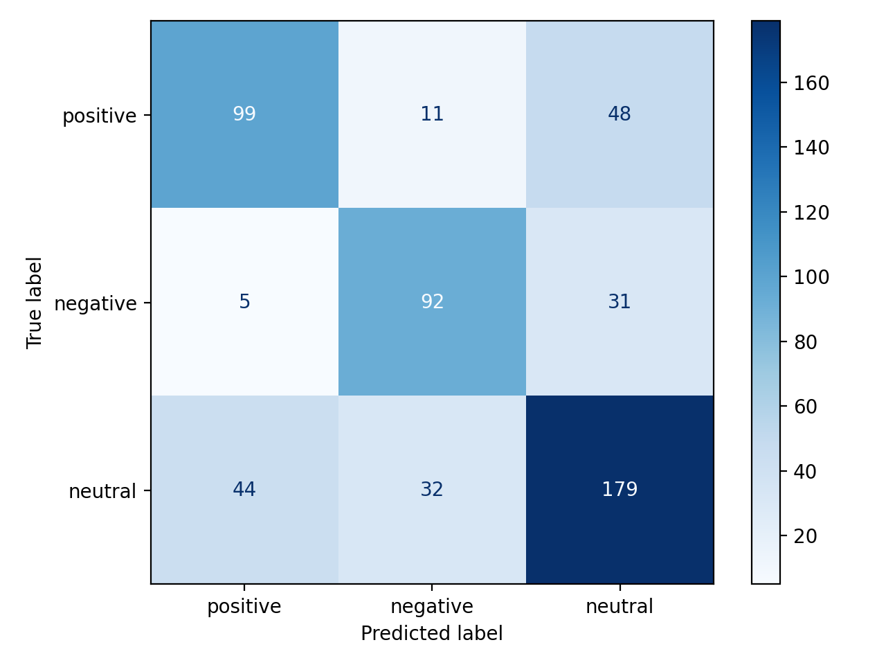

# Telugu Sentiment Classification with Multilingual Transformers

A comparative study of **mBERT**, **XLM-RoBERTa**, and **IndicBERT v2** on three-class Telugu sentiment classification (positive, negative, neutral), including a **training-data-size study** and error analysis.


---

## Overview

Telugu is spoken by over 80 million people but remains under-resourced in NLP. This project fine-tunes three multilingual pretrained models on the Telugu subset of IndicGLUE and compares them with classical TF-IDF baselines. Each model is trained on 10%, 25%, 50%, and 100% of the training data to measure data efficiency.

## Dataset

- **Source:** IndicGLUE `inltkh.te` (Telugu), loaded through Hugging Face Datasets
- **Task:** 3-class sentiment classification (positive, negative, neutral)
- **Size:** 4,328 train / 541 validation / 541 test examples

## Results

Test-set results for models trained on the full training set (seed 42):

| Model | Accuracy | Macro-F1 |
|---|---|---|
| Logistic Regression (TF-IDF) | 0.525 | 0.472 |
| Linear SVM (TF-IDF) | 0.523 | 0.500 |
| mBERT | 0.608 | 0.591 |
| XLM-R base | 0.652 | 0.650 |
| **IndicBERT v2** | **0.671** | **0.671** |

### Macro-F1 vs. training data size

| Model | 10% | 25% | 50% | 100% |
|---|---|---|---|---|
| mBERT | 0.389 | 0.529 | 0.544 | 0.591 |
| XLM-R base | 0.373 | 0.543 | 0.650 | 0.650 |
| IndicBERT v2 | 0.214 | 0.577 | 0.663 | 0.671 |




### Key findings

- IndicBERT v2 is the best model and beats the best TF-IDF baseline by about 17 macro-F1 points.
- IndicBERT v2 is the best model at every training size from 25% upward.
- With 10% of the data and default settings, IndicBERT did not learn (macro-F1 0.214); more epochs and a higher learning rate raised it to 0.624.
- Full-data results over 3 seeds: IndicBERT 0.679, XLM-R 0.654, mBERT 0.583 macro-F1. IndicBERT vs XLM-R is not statistically significant.

## Training setup

| Setting | Value |
|---|---|
| Epochs | 4 |
| Learning rate | 2e-5 |
| Effective batch size | 16 (8 per device x 2 gradient accumulation) |
| Max sequence length | 128 |
| Frozen layers | Word-embedding layer (to fit in memory) |
| Seed | 42 |
| Hardware | Apple M2 (MPS backend) |

## Project structure

```
.
├── prepare_data.py      # downloads the dataset to data/
├── baseline.py          # TF-IDF + Logistic Regression / Linear SVM
├── finetune.py          # fine-tunes mBERT / XLM-R / IndicBERT
├── analyze.py           # builds tables, plots, error samples
├── start.sh             # runs the full pipeline
├── requirements.txt
└── results/             # metrics, plots, error samples
```

## How to run

```bash
# 1. Clone the repository
git clone https://github.com/Sandilya-17/Final-project.git
cd Final-project

# 2. Create an environment and install packages
python3 -m venv venv
source venv/bin/activate
pip install -r requirements.txt

# 3. Download the data
python prepare_data.py

# 4. Run everything (baselines + 12 fine-tuning runs + plots)
bash start.sh
```

Run a single experiment:

```bash
python finetune.py indicbert 1.0     # model: mbert | xlmr | indicbert, fraction: 0.1-1.0
```

Outputs are saved in `results/`: `summary.csv`, `learning_curve.png`, `confusion_matrix.png`, and `errors_to_analyze.csv`.

> On Apple Silicon the GPU is used automatically. Full training takes about 2 hours on an M2 Mac.

## Limitations

- One dataset and one language, with short texts.
- A single fixed hyperparameter setting for all models, with no tuning.
- Word embeddings were frozen for all models because of hardware memory limits.
- One random seed per run.

## Citation

If you use this work, please cite:

```bibtex
@misc{sandilya2026telugu,
  author = {Sandilya},
  title  = {Telugu Sentiment Classification with Multilingual Transformers},
  year   = {2026},
  url    = {https://github.com/Sandilya-17/Final-project}
}
```

## Acknowledgements

- [AI4Bharat](https://ai4bharat.iitm.ac.in/) for IndicGLUE and IndicBERT
- [Hugging Face](https://huggingface.co/) Transformers and Datasets

## Contact

**Sandilya** · sandilya939174@gmail.com

## Extended experiments

More seeds, a warmup/trainable-embedding ablation, MuRIL and Telugu-BERT, a label-mapping check and a second
dataset are described in [EXTENDED_EXPERIMENTS.md](EXTENDED_EXPERIMENTS.md). Start with
`python verify_labels.py`, then `bash run_extended.sh seeds|ablation|newmodels|dataset2|stats`.
